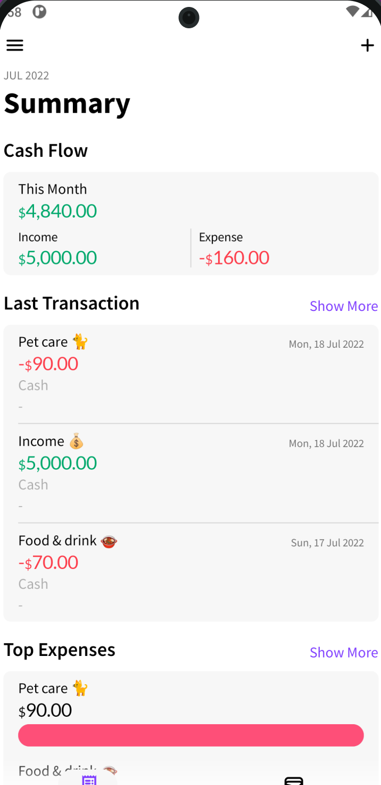

# Pocket Expense - Expense Tracker

Android application built with Kotlin and Jetpack Compose for tracking daily expenses, managing accounts, and viewing monthly cash flow.

<p align="center">
  
</p>

## Features

- Track daily income and expenses by category
- Manage multiple cash and bank accounts
- View monthly summary and cash flow balance
- Local offline storage using Room SQLite database
- Light and dark theme support with Material Design 3

## Tech Stack

- Kotlin
- Jetpack Compose (Material 3)
- Room SQLite Database
- Dagger Hilt (Dependency Injection)
- Kotlin Coroutines & Flow

## Getting Started

1. Clone the repository:
```bash
git clone https://github.com/davyd9/pocket-expense-android.git
cd pocket-expense-android
```

2. Copy the Firebase configuration template (optional for local offline Room SQLite builds):
```bash
cp app/google-services.json.example app/google-services.json
```

3. Open the project in **Android Studio** (Giraffe or newer), sync Gradle dependencies, and run the `app` configuration on an emulator or physical Android device (API 26+).
